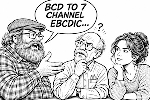

 
    <h1>Welcome to my site</h1>
    
     

  
<h2>About the cartoon.</h2> Some years back maybe in 1973 at a meeting, one of New York State Department of Transportation computer specialists said "...BCD to Seven Channel EBCEDIC". I heard it as "Ipsidic." It was made regarding a program that a colleague of mine and I were interested in having distributed within the Department. Clearly, I was impressed by the statement because it stuck with me over these many years. I do not know if it was a solution to some problem we were having or an indication of a problem we would encounter. We never did distribute the program so it was probably the latter. Extended Binary Coded Decimal Interchange Code (EBCEDIC) is used mostly in IBM mainframe work. It is similar to ASCII but not identical.  BCD is Binary Coded Decimal. 

 <h2>Now about the site.</h2>   Other contents will include two written articles and three tables aiding in the conversion of numbers between binary, octal, decimal, and hexadecimal.

## The articles

* An article on a quicker procedure to obtain negative numbers in binary
* A chatGPT generated article on the comparative power of computers from mainframes in the 60s to modern day laptops.

## The base converting tables

* First, a table for numbers as high as FFFF FFFF hex (4,293,918,720). (letter size)
* Second, a table for numbers as high as 000F FFFF hex (1,048,575). (4" by 6")
* Third, a table for converting numbers using a calculator.  It's basically the decimal equivalents of n/16, where n are values 0 to 15. (also 4" by 6")

